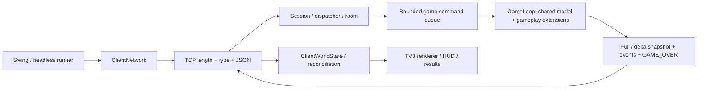

# Báo cáo kỹ thuật bàn giao — 22/10/2026

Ứng dụng Java 25+, Swing và TCP, phòng 2–4 người. Server quyết định movement/collision,
bom/chain reaction/block/item, chỉ số, damage/chết và kết quả. Client gửi ý định và hiển thị state.
Profile M1 legacy chỉ có movement; bản lobby mặc định mới có gameplay đầy đủ.

Socket reader xử lý frame/route và enqueue command; thay đổi world chạy trên game thread.
Bomb extension và item adapter dùng cùng model/map, không tạo world cạnh tranh.
Snapshot worker đưa frame vào queue writer của session; Swing nhận cập nhật qua UI executor.
Listener/timer/socket/worker có vòng đời gắn match, session hoặc cửa sổ.

Protocol chính thức: [protocol.md](protocol.md), bản tóm tắt ở [PROTOCOL.md](../PROTOCOL.md).
Handshake protocol 2; envelope match UUID ngăn dữ liệu lượt trước lọt vào lượt mới.
Input có sequence; snapshot có tick/baseline và ACK. Full state khôi phục khi delta không áp dụng được.
Snapshot v3 bổ sung bomb effects, v4 bổ sung stats/time/results, v5 bổ sung mạng/khiên/hồi sinh; không đồng nhất version snapshot với version handshake.
Client bỏ snapshot cũ và khử event lặp theo eventId; event trình bày không tự gây damage/pickup lần hai.
Final snapshot đi trước GAME_OVER trong cùng writer queue; bảng kết quả lấy dữ liệu server.

Luật mặc định: fuse 3 giây, quota 1, range 1; item drop 75%; 3 mạng/người, trận 180 giây.
Năm item và hồi sinh/khiên: [EXTENDED_ITEMS_LIVES.md](EXTENDED_ITEMS_LIVES.md).
Còn một người sống: WIN; không ai sống hoặc timeout: DRAW. Leave/disconnect/host End: ABORTED.
Chơi lại tạo runtime/state mới và reset ready. Chi tiết, cấu hình và bằng chứng:
[bom server](TASK6_SERVER_BOMBS.md), [bom client](TASK7_CLIENT_BOMBS.md),
[item/kết quả](TASK8_ITEMS_RESULTS.md).

## Độ ổn định và phạm vi kiểm thử

Queue/rate/deadline hữu hạn ở server và client; slow writer bị đóng bởi write guard,
heartbeat quản lý session im lặng; lỗi callback/runtime được cô lập và cleanup.
Giới hạn cụ thể và 20 match/10 server cycle stress nằm trong [TASK9_STABILITY.md](TASK9_STABILITY.md).
Đây là stress hữu hạn, không phải chứng minh chạy ổn định nhiều giờ hoặc tải tối đa.

Bộ kiểm thử gồm codec/framing, lifecycle phòng, movement, collision, gameplay, duplicate/order/resync,
tranh item/cùng chết/timeout/replay, lỗi mạng/runtime/cleanup và công cụ đo CSV.
Kết quả chạy cuối cùng được ghi ở [TASK10_HANDOVER.md](TASK10_HANDOVER.md),
số liệu gốc và cách tính ở [NETWORK_MEASUREMENTS.md](NETWORK_MEASUREMENTS.md).
Hướng dẫn tái chạy: `scripts/test.cmd`; Maven đơn lẻ không bao gồm các Check/Demo main và NetworkTest main.

## Hạn chế còn lại

- Chưa nghiệm thu GUI trực tiếp trên nhiều desktop, LAN nhiều máy, Wi-Fi/jitter/mất mạng thực tế.
- Số đo hiện tại ngắn, loopback và tải có kiểm soát; chưa profile CPU/RAM hoặc đo khả năng phục vụ tối đa.
- CSV đếm frame ứng dụng, không đo TCP/IP overhead, retransmission hoặc packet loss từ capture.
- Chưa soak nhiều giờ hoặc chạy trên Linux/macOS; baseline hiện hành là Java 25, xem [chuyển đổi JDK](JDK25_MIGRATION.md).
- Reconnect ứng dụng chưa bật; cần thỏa thuận session authentication, kết nối cũ và sequence/ACK trước lượt riêng
  theo [RECONNECT_ASSESSMENT.md](RECONNECT_ASSESSMENT.md).
- Không có tài khoản đăng nhập/TLS, dedicated installer hay JRE kèm gói; đây là phạm vi demo LAN hiện tại.
- Extension tùy biến block vô hạn không có bảo đảm cưỡng bức dừng an toàn trong Java.

Việc bàn giao có thể tái tạo bản chạy và kiểm thử tự động; nghiệm thu nhiều máy cần nhóm bổ sung
biên bản [LAN_GUIDE.md](LAN_GUIDE.md), video theo [DEMO_SCRIPT.md](DEMO_SCRIPT.md) và CSV riêng.
